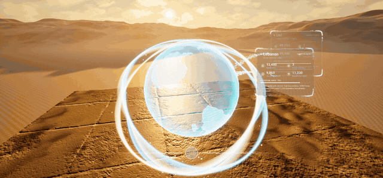
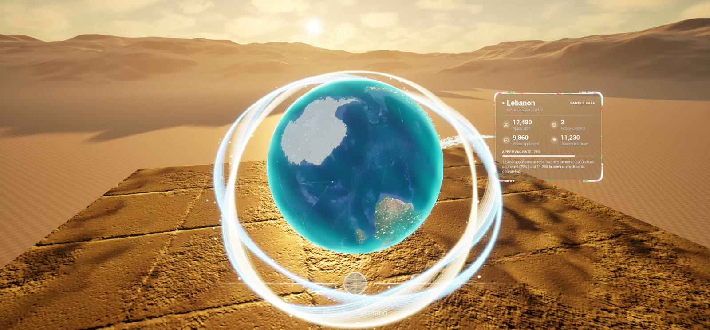
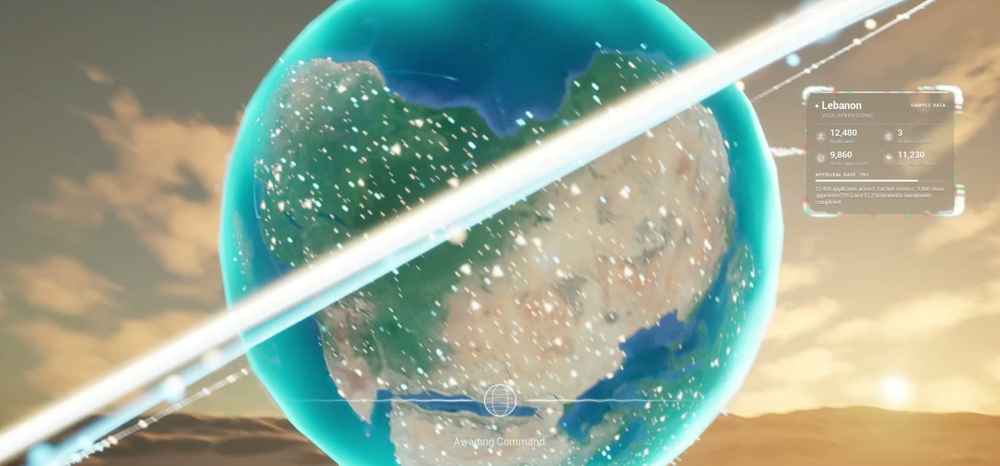
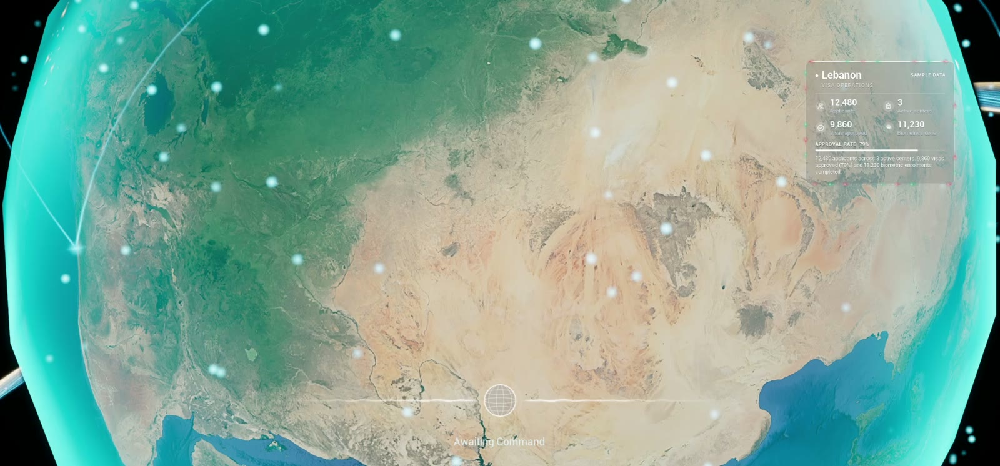
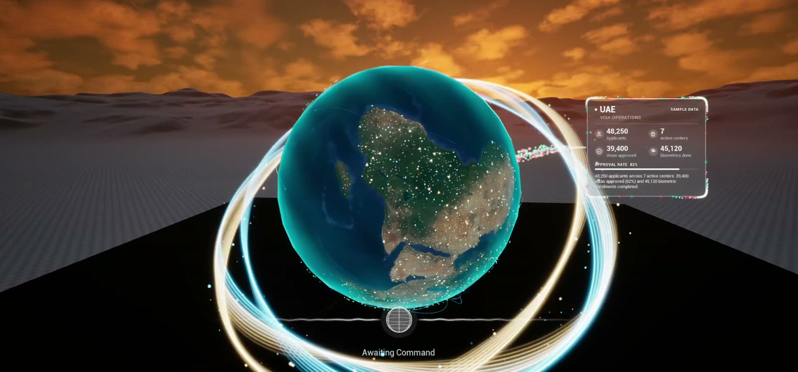
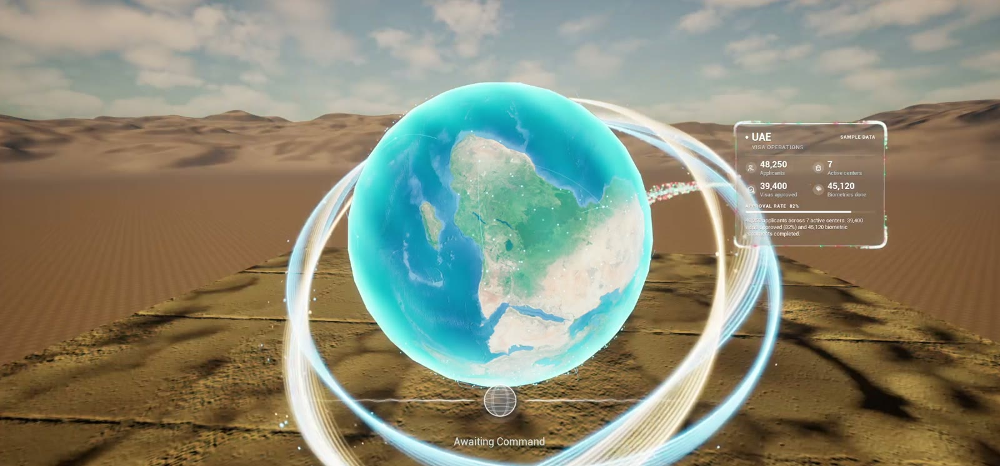
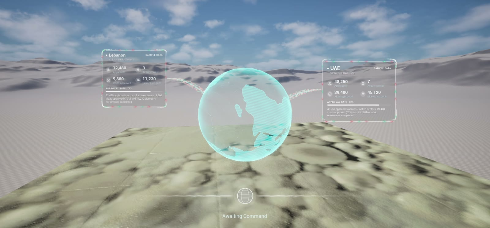

# Holographic Globe VFX — Unreal Engine 5

A real-time holographic Earth built in **Unreal Engine 5.6** with C++, Niagara and UMG. It's an "AI assistant" style
globe with orbiting light ribbons, a particle surface shell, animated data links into glass stat cards, a
voice-reactive visualizer and a real solar time-of-day system.

<p align="center">
  
</p>

## Video

<!-- To get an inline player: edit this README on github.com, delete this comment and the link below,
     and drag docs/media/showcase.mp4 into the editor. GitHub turns it into an embedded video. -->
▶️ **[Watch the full showcase (≈1.5 min)](docs/media/showcase.mp4)**

## Screenshots

| | |
|:---:|:---:|
|  |  |
| Hologram over the desert at sunrise | Prism ribbons orbiting the real globe |
|  |  |
| Close-up with the particle surface shell | Sunset with the city lights on the night side |
|  |  |
| Daylight with the cloud ring | Data links feeding two glass stat cards |

## Features

- **Hologram ↔ real globe crossfade.** A translucent Fresnel-rim hologram material swaps with the textured Earth
  using per-part timing and easing curves.
- **Niagara surface shell.** A persistent point cloud on the sphere surface, masked by a baked land/ocean texture, with
  vortex flow and back-side fading.
- **Prism ribbons.** Stacked, undulating ring sheets (World Position Offset in the material) shaded like a soft
  light ribbon, with sparkle sprites.
- **Cloud ring.** A thin luminous waveform band that reacts to audio energy.
- **Network layer.** Floating nodes joined by stable arcs with travelling pulses. It is built as a single procedural
  mesh, so it takes one draw call and no per-frame CPU work.
- **Data links and stat cards.** Up to 4 curved Niagara particle streams run from behind the globe to glass UMG cards.
  They're camera-relative, so they stay aligned while you orbit or zoom or the viewport resizes. Particles run
  around the card edges in each country's flag colours.
- **Voice visualizer.** Live microphone capture (AudioCapture) turned into a smoothed level and an 80 Hz–5 kHz
  spectrum, drawn as mirrored bars or glowing waves around a small wireframe globe ("Awaiting Command" → "Listening").
- **Time of day.** Moves the sun along a real solar path for any hour, latitude and season. Sky Atmosphere, Volumetric
  Cloud and fog follow it, and city lights fade in on the night side.
- **Procedural asset pipeline.** Editor-only C++ generators and commandlets build the materials, Niagara systems
  and Widget Blueprints idempotently. They can run headless.

## Controls (Play in Editor)

| Input | Action |
|---|---|
| Left mouse drag | Orbit camera |
| Right mouse drag | Rotate the globe |
| Middle mouse drag | Pan |
| Mouse wheel / `=` `-` | Zoom |
| `F` | Reset view |
| `S` | Crossfade hologram ↔ real globe |
| `R` | Toggle prism ribbons |
| `[` / `]` | Scrub time of day (hold) |
| `T` | Toggle time-of-day auto-advance |
| Microphone | Drives the voice visualizer |

All keys can be changed on the `GlobeViewerPawn` in the Details panel.

## Tech

Unreal Engine 5.6 · C++ · Niagara · UMG / Slate · Procedural Mesh Component · Audio Capture · Enhanced Input

## Getting started

### Requirements
- Unreal Engine **5.6**
- Visual Studio 2022 with the *Game development with C++* workload (see `.vsconfig`)

### Third-party assets (not included)

This project uses free assets from [Fab](https://www.fab.com/). Their license doesn't allow redistributing them,
so they aren't in this repository. Add them to your Fab library and place them at these paths:

| Asset | Expected path | Used for |
|---|---|---|
| **Earth Globe** | `Content/Fab/Earth_Globe_🌍/earth_globe/` | The real Earth mesh and textures (also the source for the land and city mask bakers) |
| **Marble Tile** | `Content/Fab/Marble_Tile/` | `pavement_06` material on the ground platform |

Without them the project still opens and the hologram layers fall back to a built-in sphere. Only the textured globe
and the platform material will be missing. The baked land and city masks are already included.

### Build & run
1. Clone the repo.
2. Right-click `VFX.uproject` → **Generate Visual Studio project files**.
3. Open `VFX.sln`, build **Development Editor | Win64**, then launch. Or double-click `VFX.uproject` and let it compile.
4. `Prototype_map` opens by default. Press **Play**.

### Regenerating the generated assets (optional)

```bash
UnrealEditor-Cmd.exe VFX.uproject -run=GenerateGlobeMaterials -unattended -nosplash -AllowCommandletRendering
UnrealEditor-Cmd.exe VFX.uproject -run=InspectGlobeScene     # read-only diagnostics
# The land/city mask bakers (AIGlobe.* console commands) need the Fab Earth Globe mesh.
```

## Project layout

```
Source/VFX/Globe/          Runtime: globe actor, viewer pawn, Niagara/mesh layers, stat cards, voice input, time of day
Source/VFXEditor/Globe/    Editor-only generators (materials, Niagara, widgets, land-mask baker) and commandlets
Content/AIGlobe/           Generated materials, Niagara systems, masks and Widget Blueprints
Content/Prototype_map      Showcase level
```

## License

The code is released under the [MIT License](LICENSE). Third-party Fab assets and Unreal Engine are covered by
their own licenses.
